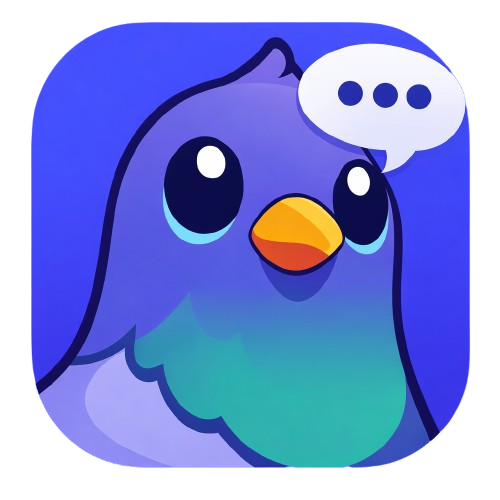

<p align="center">
  
</p>

<p align="center">
  <a href="https://github.com/haskou/pigeon-swarm-ui/actions/workflows/ci.yml">
    
  </a>
  <a href="./LICENSE">
    
  </a>
</p>

# pigeon-swarm-ui

`pigeon-swarm-ui` is the browser client for `pigeon-swarm-node`, the backend
node of Pigeon Swarm: a peer-to-peer communication platform built around
self-hosted nodes, user-owned identities, and client-side encrypted
conversations.

The UI talks to a local node over signed HTTP requests and an authenticated
WebSocket connection. It is responsible for identity creation and login,
profile editing, keychain handling, message encryption, attachment encryption,
and the user experience around conversations, channels, groups, communities,
networks, and node management.

The backend stores and syncs opaque encrypted payloads. The browser keeps
private keys, passwords, decrypted keychains, and decrypted conversation or
community keys local.

## Why pigeons?

Carrier pigeons are low-tech, decentralized message delivery with excellent
branding. They do not need a corporate inbox, a central timeline, or a blessed
server to know where they are going.

The name is partly a joke, partly a design reminder: messages should move
through the swarm without asking permission from one big place.

## Networks and communities

The UI exposes two different access layers: networks and communities.

Networks define which nodes can discover, connect, and exchange events with each
other. Public networks can be joined openly. Private networks require permission
before outside nodes can connect, so unknown nodes cannot simply appear and
participate.

Communities define the social spaces users interact with inside those networks.
Public communities can be visible and accessible to users in the network.
Private communities can restrict who can see them, join them, or participate in
their channels and conversations.

In short: networks control node access, while communities control user and
content access. Keeping both separate avoids turning every permission check into
a tiny distributed hostage negotiation.

## Capabilities

- Local identity registration and login by identity id or handle.
- Profile editing with handle, name, biography, avatar and banner CIDs.
- Client-owned encrypted keychains for conversations.
- Private communities encrypted with MLS (RFC 9420) groups, one leaf per
  device, rekeyed when members leave or are removed. See
  [MLS group encryption](./docs/mls-group-encryption.md).
- One-to-one and group conversations with encrypted messages, replies,
  attachments, deletion tombstones and unread state.
- Public and private communities with members, text channels, encrypted channel
  messages and owner management UI.
- Conversation, group conversation and community invitations.
- Public IPFS uploads for profile/community media.
- Private encrypted IPFS uploads for message attachments, including large-file
  chunking.
- Realtime updates over WebSocket for conversations, communities,
  notifications and peer state.
- Node first-run flow, public/private network management, peer metrics and
  connection-loss handling.
- English and Spanish UI copy, selectable from the profile menu.

## Architecture

The frontend is organized around bounded frontend contexts plus shared
application composition:

- `src/contexts`: feature contexts such as identities, conversations,
  communities, messages, attachments, calls, polls, stickers, notifications and
  networks. Each context owns its application, domain, infrastructure and
  presentation slices where they are needed.
- `src/app`: application composition, workspace orchestration and high-level
  presentation shell.
- `src/shared`: cross-context domain primitives, HTTP/realtime infrastructure,
  media helpers, shared UI components, hooks and i18n.

The UI uses `@haskou/value-objects` for cryptographic value objects and signing
primitives where possible. Private keys, passwords, decrypted keychains and
decrypted conversation/community keys are not sent to the node.

Conversation creation and group roster changes (add, remove, leave, promote and
demote admin) are signed by the active device credential as conversation
operations over the node's current frontier. Group ids are derived client-side
from a creator-chosen nonce, and the node only verifies and replicates them.

## Backend Contract

The UI expects a `pigeon-swarm-node` instance running locally at:

```http
http://localhost:8080/
```

The default API URL is currently configured in:

- [`src/app/API_SERVER_URL.ts`](./src/app/API_SERVER_URL.ts)

Important backend docs live in the node repository:

- [`docs/api.md`](https://github.com/haskou/pigeon-swarm-node/blob/main/docs/api.md)
- [Realtime WebSocket API](https://github.com/haskou/pigeon-swarm-node/blob/main/docs/api.md#realtime-websocket-api)
- [`src/apps/apis/open-api.yaml`](https://github.com/haskou/pigeon-swarm-node/blob/main/src/apps/apis/open-api.yaml)

## Development

Install dependencies:

```bash
yarn
```

Run the development server:

```bash
yarn dev
```

The Vite dev server listens on all interfaces. If the default port is busy,
Vite will choose the next available port.

Common commands:

```bash
yarn lint
yarn test
yarn typecheck
yarn build
yarn preview
```

This repository does not currently require a `.env` file. The default node URL
is `http://localhost:8080/`, set in `src/app/API_SERVER_URL.ts`. Set
`VITE_API_SERVER_URL` when Vite starts to point the combined build at another
node.

## Runtime Dependencies

For the full experience, the browser client expects:

- A running `pigeon-swarm-node` HTTP/WebSocket API.
- A claimed or claimable local node.
- At least one configured node network.
- IPFS public/private upload endpoints exposed by the node.
- Signed request support from the active identity.
- WebSocket `/realtime/v1` support for realtime domain events, authenticated with single-use tickets.

The app can still render connection-loss and first-run screens when the node is
offline or unclaimed.

## Security Model

The frontend is responsible for:

- generating separate stable identity, recovery-authority and per-device keys;
- wrapping the local root key with the password and a random, non-exportable
  device factor stored in IndexedDB;
- keeping passwords, root-key envelopes and private keys out of published
  identity, IPFS and OrbitDB state;
- changing passwords by rewrapping local material without rotating identity keys;
- enrolling devices through short-lived, mutually authenticated QR transfers;
- replacing every enrolled device from the offline recovery kit;
- signing HTTP requests, including the request that issues each realtime WebSocket ticket;
- signing domain payloads for identities, messages, deletions and keychains;
- encrypting keychains before publication;
- encrypting conversation and community message payloads;
- encrypting private attachments, padded to size buckets, before upload;
- decrypting attachments only when previewing or downloading them.

The backend is responsible for:

- verifying signed requests and domain signatures;
- storing public identity/community metadata;
- storing opaque encrypted payloads;
- publishing and retrieving IPFS content;
- routing realtime events to related identities;
- syncing node state through configured networks.

### Attachment size padding

Private attachment plaintext is framed before AES-256-GCM encryption, so the
uploaded length reveals a size bucket rather than the exact file size:

- Frame: the 8-byte ASCII magic `PGPAD001`, an 8-byte big-endian payload length,
  the payload, then zero bytes up to the bucket size.
- Buckets: 1 KiB, 4 KiB, 16 KiB, 64 KiB, 256 KiB, 1 MiB, 4 MiB, 16 MiB, then
  52,428,688 bytes (50 MiB minus 112). That top frame encrypts to exactly 50 MiB,
  the node's default `PRIVATE_BLOB_MAX_BYTES`, because each 8 MiB AES-GCM chunk
  adds a 16-byte tag. The bucket is the smallest one that holds the whole frame,
  header included. Frames above the top bucket are not padded.
- Marker: new encryptions set `padding: "length-prefix-v1"` in the attachment's
  `encryption` metadata. Receivers strip the frame only when the marker is present
  and reject a frame whose magic or length is invalid.
- Attachments without the marker were encrypted before padding and are decrypted
  unchanged.

### Attachment blob origins

- Each private attachment part records the canonical base URL of the node that
  stores it in `origin`. Receivers read the part from that node, even when their
  session is on another node.
- The origin uses the `MailboxHomeBase` canonical form: `https` (or `http` on
  loopback for development), no credentials, query, or fragment, no trailing
  slash, at most 255 characters, and no private or loopback IP addresses. The
  `localhost` name is accepted for development.
- An origin that fails this rule is ignored. The part is read from the session
  node instead, and the invalid value is never fetched.
- References without `origin` were created before the field existed and are read
  from the session node.
- Reads use an isolated client with `credentials: omit` and `redirect: error`.
  A body whose size differs from the reference, or a 404, reports the attachment
  as unavailable. Other failures surface as the original error.
- Alternate replicas are not implemented yet; see `docs/design/private-blob-store.md`
  in the node repository.

## Project Status

This is active development software. Conversations, communities, invitations,
attachments and realtime behavior are already usable, but contracts may still
move as the backend and frontend settle.

Expect APIs, UI flows and cryptographic payload shapes to keep evolving while
the project grows.

## License

Pigeon Swarm is licensed under the PolyForm Noncommercial License 1.0.0. See
[LICENSE](LICENSE) for the full license text.

Commercial use requires a separate commercial license from the author.

## Notice

Additional usage notices are available in [NOTICE](NOTICE).

## Third-party assets

This project may include or reference third-party assets. See [ATTRIBUTIONS.md](./ATTRIBUTIONS.md).

## Disclaimer

Pigeon Swarm is not affiliated with, endorsed by, or sponsored by Discord Inc, NEXON, NEXON Games, Yostar, or the Blue Archive team.
Discord is a trademark of Discord Inc.

## Independent client build

Build with `VITE_INDEPENDENT_CLIENT=true yarn build` to choose a separate node before application bootstrap. `VITE_API_SERVER_URL` configures the existing combined build and is ignored by the independent client.

The node must expose `GET <node-base>/client-contract`, including the selected API prefix (for example, `/api/client-contract`), with HTTP 200 and JSON `{ "protocol": "pigeon-swarm", "apiVersion": 2 }`. This public, non-cacheable discovery endpoint uses the node API’s CORS policy. The version identifies the breaking-major API contract, independently of the software release; an unsupported version prevents application startup. The authoritative [API contract](https://github.com/haskou/pigeon-swarm-node/blob/main/docs/api.md#client-compatibility-discovery), [endpoint schema](https://github.com/haskou/pigeon-swarm-node/blob/main/src/apps/apis/nodes-api/swagger.yaml), and [aggregate OpenAPI declaration](https://github.com/haskou/pigeon-swarm-node/blob/main/src/apps/apis/open-api.yaml) are maintained in the backend repository.

The independent build must be served from a trusted client origin with the static server and security headers provided by [the deployment repository](https://github.com/haskou/pigeon-swarm/blob/main/docs/INDEPENDENT_CLIENT.md). That guide covers verified images, TLS, updates, rollback, node-scoped storage, and distributor trust. The service worker retains notifications but bypasses resource caching in this mode.

Independent-client HTTP fetches omit ambient cookies and reject redirects. Realtime WebSocket connections authenticate with a single-use ticket rather than cookies or signed query parameters: every connection, including each reconnect, first requests a ticket from `POST <api-base>/realtime/v1/tickets` and then presents it in the `ticket.<token>` subprotocol, so the URL never carries credentials. Browsers may still attach cookies for the selected node to the handshake, and the node ignores them for authentication. Use an API hostname outside unrelated services’ cookie scopes, while recognizing that dedicated hosting does not guarantee an empty cookie jar. Credentialless realtime transport is tracked in [pigeon-swarm-node#291](https://github.com/haskou/pigeon-swarm-node/issues/291).
